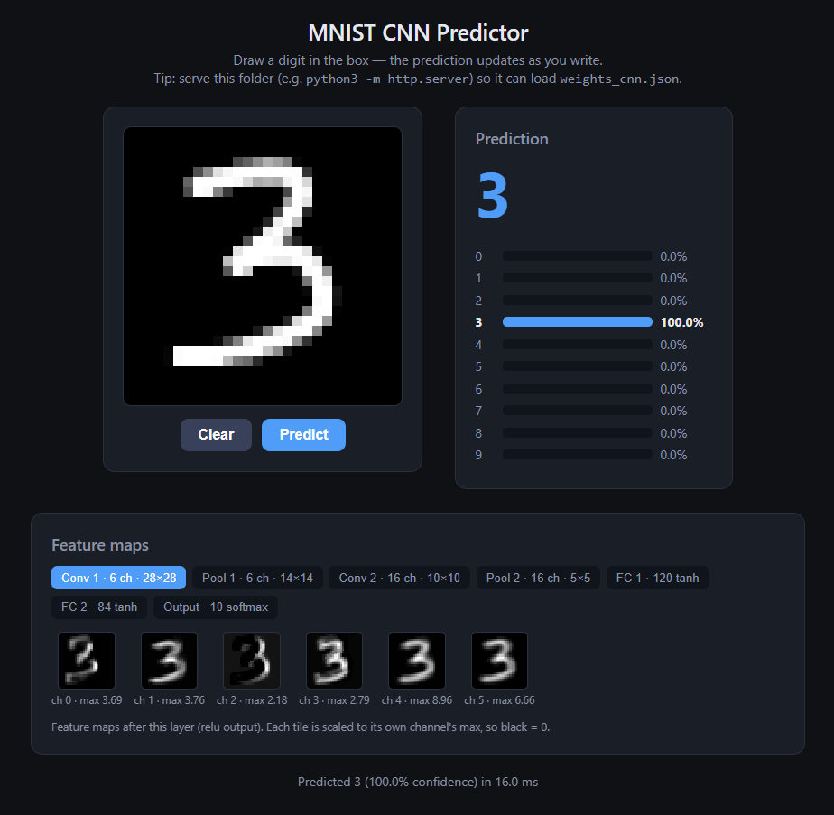

## @scinorandex/scinn

A TypeScript library for creating and training simple neural networks. 

### Rationale

The primary purpose of the project is to serve as a learning tool on how neural networks learn with easy to understand implementation details on common architectures like multilayer perceptrons (MLPs) and convolutional neural networks (CNNs).

It is not meant to be used in production, it has a limited set of features and primarily does not support hardware acceleration.

### Examples:

Here is an implementation of a regular multilayer perceptron, tasked to solve digit classification over the MNIST dataset:

```ts
const nn = new NeuralNetwork();
nn.add_layer(new FullyConnectedLayer(784, 64, sigmoid, seed++))
  .add_layer(new FullyConnectedLayer(64, 32, sigmoid, seed++))
  .add_layer(new FullyConnectedLayer(32, 10, softmax, seed++));
nn.describe({ rows: 1, columns: 784 });
```

Here is an implementation of LeNet, a convolutional neural network architecture, for solving the same problem:

```ts
const nn = new NeuralNetwork();
nn.add_layer(new ConvolutionalLayer({ rows: 5, cols: 5, input_channels: 1, output_channels: 6 }, relu, seed++, { padding: 2 }))
  .add_layer(new AveragePoolingLayer({ rows: 2, cols: 2 }))
  .add_layer(new ConvolutionalLayer({ rows: 5, cols: 5, input_channels: 6, output_channels: 16 }, relu, seed++))
  .add_layer(new AveragePoolingLayer({ rows: 2, cols: 2 }))
  .add_layer(new FlattenLayer(5, 5, 16))
  .add_layer(new FullyConnectedLayer(400, 120, tanh, seed++))
  .add_layer(new FullyConnectedLayer(120, 84, tanh, seed++))
  .add_layer(new FullyConnectedLayer(84, 10, softmax, seed++));
nn.describe({ rows: 28, columns: 28, channels: 1 });
```

### Training

Once you have constructed your neural network it is now time to begin training.

```ts
// Load, split, and shuffle the samples
const samples = load_mnist_square();
const training = samples.filter((e, i) => i <= 4096);
const testing = samples.filter((e, i) => i > 4096 && i < 8192);
const shuffled_training = fisher_yates(training, mulberry32(seed++));

// Train the neural network using the following parameters
const learning_rate = 0.05;
const batch_size = 32;
const max_epochs = 100;
const benchmark = new ClassificationCrossEntropyBenchmark(testing, 10);
nn.train(shuffled_training, { max_epochs, batch_size, learning_rate, benchmark }).save("weights_cnn.json");
```

### Implemented layers

 - `FullyConnectedLayer` - accepts and returns a 1D matrix as an input
 - `ConvolutionaLayer` - accepts and returns a 3D matrix as an input with `rows x columns x channels` for dimensions. It can learn multiple kernel over the input data and output multiple activation maps
 - `MaxPoolingLayer` and `AveragePoolingLayer` - accepts and returns a 3D matrix, downscaling each channel
 - `FlattenLayer` - accepts a 3D matrix and returns a 1D matrix of the concatenated rows and channels

Each layer is implemneted as a class that implements methods specific to the layer, like their forward and backward pass calculations. 

Forward pass calculations are stored for use in the backwards pass. Calculated weight updates are accumulated for an entire batch, and applied at the end of each, **implementing stochastic gradient descent (SGD)**.

A benchmark is applied every 10 epochs against the test set to see if the model is regressing. If overall accuracy is lower than the previous benchmark, the training is stopped early.

---

### Interactive Demo



`predict.html` is a standalone HTML file which takes the weights of `weights_cnn.json` and infers the class of digits drawn. 

It also shows all the intermediate activation maps per layer.

---

### References

 - [AI: A Modern Approach](https://aima.cs.berkeley.edu/) - the original CS textbook I used in college to learn Artificial Intelligence, Machine Learning, and Deep Learning.
 - [Understanding Deep Learning](https://udlbook.github.io/udlbook/) - this book inspired me to try implementing MNIST one more time after many failed attempts. It also explained the logic behind CNN based architectures easier.

### AI Disclosure

All forward and backpropogation algorithms were implemented by hand. Qwen 3.8 27B running locally was used to figure out why models weren't training, and to write `predict.html`.
